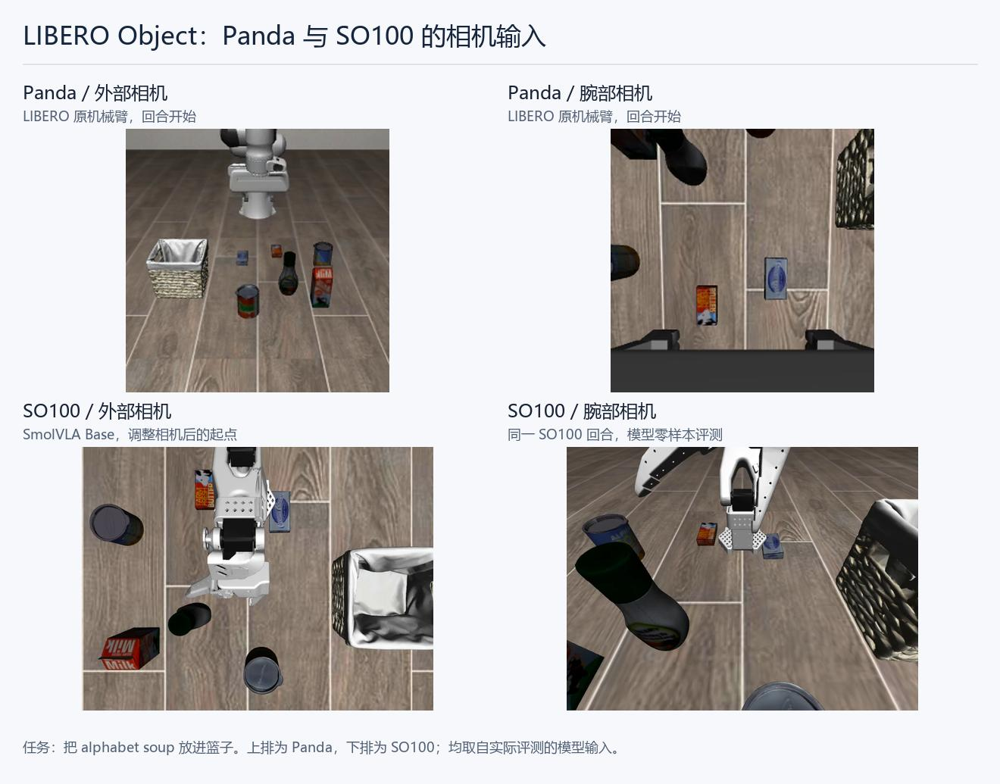
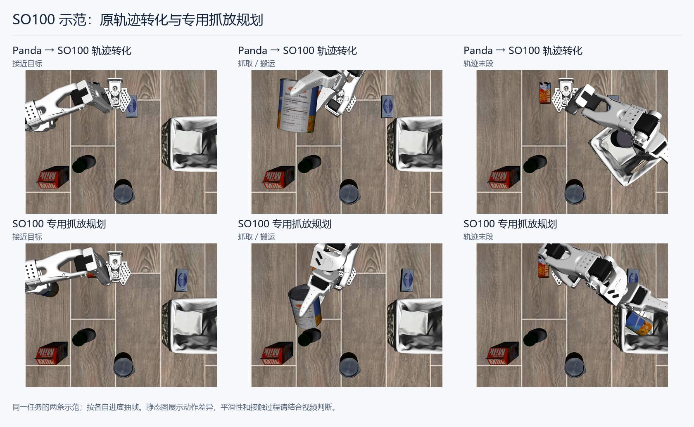
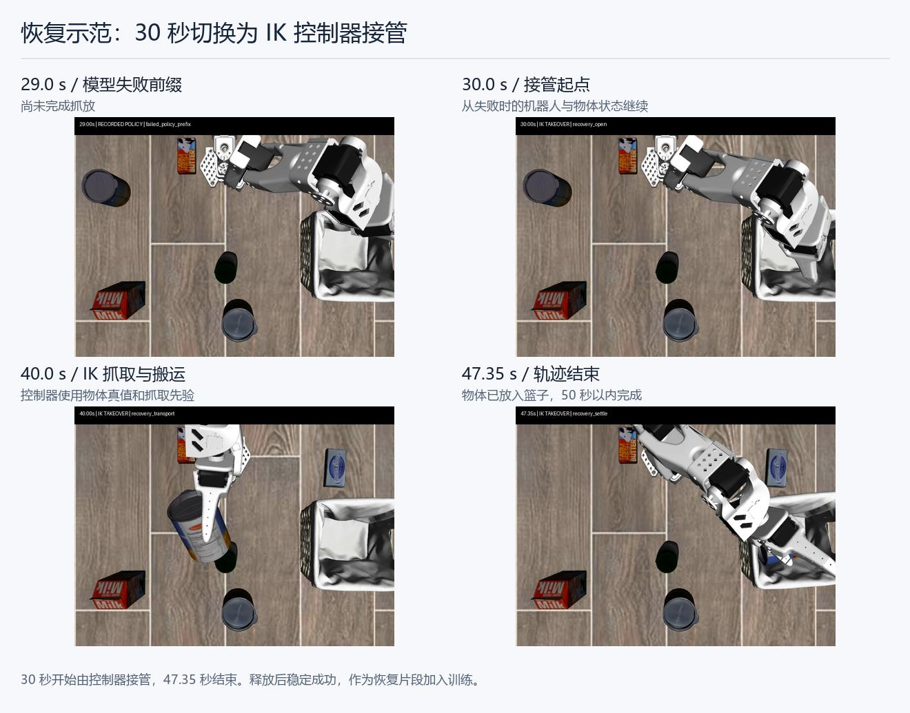
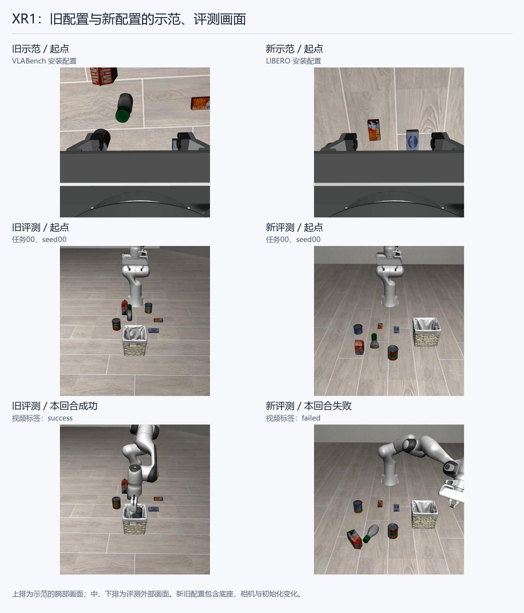

# VLA 微调究竟在适应什么？把vla和vla熟悉的机械臂直接搬进来能否完成benchmark

我们认为，机器人数据里的本体种类比较少，而 VLM 可能已经通过互联网数据学习了大量图像、指令和空间关系。迁移时需要微调，很大一部分可能是在适应本体、相机和位置标定。

那我们不妨反过来做：保留 benchmark 的任务、物体和成功判定，把vla和vla熟悉的机械臂搬进来。这样可以直接观察，原来那套视觉语言知识，能不能驱动它熟悉的本体完成新的 benchmark。

## SmolVLA + SO100：zero-shot测试

由于资源受限，一开始是 5090 × 1。我们选定经典的 LIBERO，采用 MuJoCo 仿真器；模型选 SmolVLA 官方 Base 和 LIBERO 微调版本，先从比较简单的 Object 目标识别抓放任务开始。

直接把 SO100 移植进来，调整摆放位置和相机，直接用 Base 跑。Object 共 10 个任务，每个测 5 次。很遗憾，0/50。

|模型与本体|Object 成功率|
|---|---|
|LIBERO 微调版 + Panda（baseline）|34/50，68%|
|Base + Panda|0/50|
|Base + SO100|0/50|
|Base + SO100，调整相机与起势|0/50|

分析认为有两个原因：一是相机参数未知，只能调整到合理范围，仍然存在观测差异；二是 LIBERO 为 Panda 设计，SO100 自由度更少、尺寸更小，尺寸也小，夹爪单侧开合，像蟹钳一样，有些物体不好夹。（10w的臂的性能对比2000块的臂的性能）

视频 1｜Base + SO100：有操作动作，但零样本抓放失败

https://github.com/user-attachments/assets/06278046-a259-4721-9de1-496864552c05

## 允许少量微调，示范数据从哪里来？

零样本失败后，我们换一个更弱的假设：允许 finetune，但只用很少的数据和步数。问题是，原始示范都是 Panda 的，换成 SO100 就没有对应的数据了。

第一种方法是 IK 转换。正运动学把关节角算成末端位姿（EEF），逆运动学则从末端位姿求关节角。我们把 Panda 示范的 EEF 轨迹转成 SO100 关节轨迹，再修正抓取高度、夹爪和时序，在仿真里执行并重新渲染视频，得到 10 条成功示范。微调 500 步成功率 2%，2,000 步为 18%。

但看视频会发现，直接要求 EEF 相同过于受限：SO100 太小，有些 Panda 的动作做不出来，还会钩住篮子。

受 Astra 的启发，不如让 GPT-6.1 Sol 直接设计示范：选夹爪抓取和放置位置，给出合适的 EEF 轨迹，再让 IK 求解，反复看视频、调动作。这样又做了 10 条更适合 SO100 的数据。相同的 2,000 步训练，成功率从 18% 提高到 36%。

|示范来源|训练步数|Object 成功率|
|---|---|---|
|Panda → SO100，IK 转换并修复|500|1/50，2%|
|同一份 10 条数据|2,000|9/50，18%|
|Agent 规划 + IK，10 条|2,000|18/50，36%|

视频 2｜从 Panda 轨迹重定向出发的 SO100 示范，由于so100没有panda那么长，会出现钩住篮子的情况

https://github.com/user-attachments/assets/9d03c025-d969-49cb-bea8-3b192587fc5f

视频 3｜SO100 专用规划生成的成功示范，高处放下，不动篮子

https://github.com/user-attachments/assets/c6bd19cf-4582-4fb0-b054-3e73cc7c68e1

视频 4｜SmolVLA 微调 500 步后的真实策略成功回合

https://github.com/user-attachments/assets/6e3db541-3d1a-439c-9754-a12587834368

按 API 计费，一条成功示范约花 0.2 美元。

保持10条数据不变，进一步扩展训练步数

## 恢复数据和 Panda 对照

我们还从每个任务挑一条失败轨迹，在第 30 秒让控制器 / IK 接管，50 秒内完成，生成 10 条 recovery 数据。分别用正常、恢复和混合数据训练，都是 2,000 步、BS16；混合组每步正常 8 个、恢复 8 个样本。

|训练数据|正常起点成功率|恢复起点成功数|
|---|---|---|
|正常 10 条|18/50，36%|0/10|
|恢复 10 条|1/50，2%|2/10|
|正常 + 恢复|15/50，30%|1/10|

恢复数据带来了一点恢复能力，但混合后没有超过纯正常数据。

视频 5｜失败 30 秒后由控制器接管的恢复示范数据

[▶ 查看视频 5：失败后接管的恢复示范（MP4）](assets/videos/05-so100-recovery-demonstration.mp4)

接着我用 Panda 的官方示范，从同一个 Base 微调，每任务一条、同样 2,000 步。Panda 为 46%，SO100 为 36%。两者都给 700 步，Panda 的成功均在 280 步以内，SO100 则都在 280 步之后。

我认为，Panda 确实更适合 LIBERO，官方示范也比我们合成的动作更自然。SO100 的可达性、夹爪和相机参数会牵扯太多精力，所以决定换一个更接近 LIBERO 硬件条件的模型。

## Xiaomi Robotics-1：10 条数据微调到 42%

正好资源升级成 PRO 6000 × 1，重新调研，选定 Xiaomi Robotics-1 的 VLABench 微调版本，简称 XR1。它有约 5B 权重，同样使用 Franka 和 MuJoCo，公开了机器人、三路相机和动作接口；输出 EEF 增量，也能复用之前的 IK 造数据方法。

这个版本用 VLABench 的 10 类任务、共 5,000 条示范微调。根据官方配置，接入libero zeroshot跑，很遗憾，Object 仍是 0/10。

看视频，机器人已经有接近和抓取动作，只是没抓对或没抓准。我猜 LIBERO 物件比较简陋、辨识度不高也是原因之一，我作为人第一次也认不出来。于是继续合成 10 条数据微调：冻结 VLM、打开动作模块，BS32，训练 1,000 步。

|XR1 Object，10 条示范|成功率|
|---|---|
|零样本|0/10，0%|
|100 步，seed 0|0/10，0%|
|500 步，seed 0|3/10，30%|
|1,000 步，seed 0|5/10，50%|
|1,000 步，五 seed 重测|21/50，42%|

10 条、不到 3 分钟的示范，1,000 步微调，就把 Object 从 0 提高到了 42%。

## 换初始安装配置

理论上libero原始的panda 安装位置更适合这个任务，同时也是为了对齐 LIBERO 的初始设置，把机器人移到原 Panda 安装位，重新采数据。仍训练 1,000 步、BS32；40 任务混训时，每步四组各取 8 个样本。结果 Object 反而掉点很大。

|安装配置与数据|1,000 步 Object 成功率|
|---|---|
|旧 VLABench 安装位，10 条|21/50，42%|
|LIBERO 安装位，重新采 10 条|7/50，14%|

检查发现，数据和评测都从 VLABench 安装位变成 LIBERO 安装位后，底座朝向、相机视角和场景起点也随之变化。同样是 Franka、同样的 Object 任务，换了一套安装配置，重新微调后的效果仍然差很多。

视频 6｜旧配置下 XR1 微调模型的成功评测

https://github.com/user-attachments/assets/2ef7a821-95be-4b27-aef5-65e3dc477b1b

视频 7｜新配置下 XR1 微调模型的失败评测

https://github.com/user-attachments/assets/65eb0051-7745-4d1d-afc8-4dd42059147b

## 结论

最初的猜想：任务图像和语言的泛化已经在 VLM 里学过，微调主要是在适应本体。

结果：将vla和本体同时搬到libero场景里面确实有优势，少样本迁移效果不错，我认为确实有很大一部分finetune成本是放在了适应本体上面，smolvla+SO100 能到 36%，XR1 能到 42%，都只用每任务一条数据、只训练动作侧，很少的步数。

作为对比，

我们的smolvla+so100 10条合成数据 fintune 16\*4000=6w训练窗口，object成功率50%，只解冻action专家约100m参数。

smolvla+panda finetune 1600条人类遥操数据 finetune 25,000 × 32=80w训练窗口，object成功率68%，450全量finetune

但是对于新的布局，vla+本体的适应性还是很差，个人认为与现在vla的benchmark的测试方式有关系：finetune方式一般都是finetune到出现过拟合掉点才结束，导致模型很大程度上已经学会了一些隐式等待关联，在base模型里面的泛化性和能力分布被破坏了，当遇到略微的干扰的时候很容易掉点，这个在实际的生产环境中具有很大的劣势。而vla+已经适应好的本体一起搬进来，然后使用少样本的finetune，我想可以尽可能的保留原始的能力。

## 不足和局限

1. 尝试了对除了objec任务之外的剩下30个任务，由于人工采集数据成本过高，继续沿用agent+ik方法尝试采集数据，很遗憾，这些任务，如打开柜子把碗放进去等，比较的复杂且更长，即使agent进行了多任务拆分，也不能合成高质量的成功数据。

2. 由于机械臂，数据质量和任务数不同，以及finetune时候的部分参数和全参数的区别，我们的实验baseline对比并不够公平和变量唯一，仅作为小实验。

3. 实验中如学习率等超参数缺乏统一的消融和遍历，实验结果未必最佳
